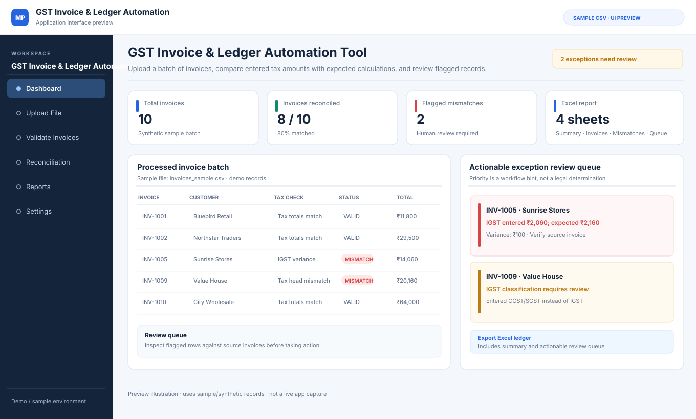

# GST Invoice & Ledger Automation Tool

A Python + Streamlit prototype that checks invoice-level GST calculations and turns discrepancies into a prioritised, review-ready queue. It demonstrates data validation, business-rule reasoning, exception triage, automated tests, and Excel reporting.

## Interface Preview (Illustrative)

> Illustrative interface preview based on the app's invoice validation and exception review features. This is not a screenshot captured from a running instance.

> **Important scope note:** This is a learning and decision-support prototype, not a full GST-compliance or reconciliation product. It uses a simplified state-comparison rule for CGST/SGST versus IGST and assumes invoice value equals taxable value plus GST. It does not implement every place-of-supply rule or cover exempt supplies, cess, discounts, freight, reverse charge, credit/debit notes, and other special cases. The review priority is a workflow hint—not a legal determination. A qualified professional must verify source documents and applicable rules.

## The problem it addresses

When an accounts team checks a batch of invoices, it may need to re-check tax components and totals row by row. A simple red “mismatch” flag still leaves the reviewer to work out what to investigate first.

This prototype aims to make that first review step more actionable: validate the batch, calculate expected values under the explicitly documented simplified rule, explain numeric differences, categorize common mismatch patterns, and put the resulting exceptions into a prioritised review queue. It does not automatically change or certify invoice data.

## Features

- Read a batch of invoices from CSV or Excel.
- Normalise column names and validate required fields, dates, numeric amounts, GST-rate bounds, and duplicate invoice IDs.
- Calculate expected tax split under the simplified same-state / different-state rule.
- Compare reported CGST, SGST, IGST and invoice total using a ₹0.02 tolerance.
- Categorise exception patterns such as tax-head allocation, tax-component amount, invoice-total, and combined discrepancies.
- Attach a suggested *human review action* to each flagged invoice—for example, checking the source invoice and tax-head treatment rather than silently changing values.
- Show an exception queue ordered by review priority, with high-priority tax-head patterns first.
- Export an Excel workbook with **Summary**, **All Invoices**, **Mismatches Only**, and **Review Queue** sheets.
- Use the same engine from a Streamlit upload/download interface or a CLI script.
- Run automated tests through pytest and GitHub Actions.

## Tech stack

- Python
- pandas
- Decimal-based money rounding
- openpyxl
- Streamlit
- pytest

## Project structure

- `app.py` — Streamlit interface, summary metrics, review queue and Excel download
- `gst_engine.py` — input validation, tax calculations, exception categories, review guidance and ledger generation
- `generate_ledger.py` — command-line entry point
- `sample_data/invoices_sample.csv` — synthetic demo data with intentional discrepancies
- `tests/test_gst_engine.py` — automated regression and triage tests
- `.github/workflows/tests.yml` — CI test workflow

## Run locally

Use Python 3.10 or later. From the repository root:

    python -m venv .venv

Windows PowerShell:

    .\.venv\Scripts\Activate.ps1

macOS / Linux:

    source .venv/bin/activate

Install the dependencies:

    python -m pip install -r requirements.txt

### Streamlit app

    streamlit run app.py

Upload `sample_data/invoices_sample.csv` or a CSV/Excel file with the required columns. Choose the seller state in the sidebar.

### Generate an Excel report from the terminal

    python generate_ledger.py sample_data/invoices_sample.csv output_ledger.xlsx Maharashtra

### Run tests

    python -m pytest -q

## Required input columns

The input file must contain:

`invoice_no, date, customer_name, customer_state, taxable_amount, gst_rate, cgst_amt, sgst_amt, igst_amt, invoice_total`

Column names are normalised for case and surrounding whitespace. Each invoice number must be unique within the uploaded batch. This demo accepts non-negative amounts; credit notes and negative-value invoices are outside scope. GST rates are percentages (for example, `18` for 18%).

## How exception triage works

The engine keeps numeric mismatch details and adds a category, a review-priority hint and a suggested next check.

| Pattern | Example review hint |
|---|---|
| Tax-head allocation | Compare the original invoice and transaction/place-of-supply facts before posting. |
| Tax component amount | Recalculate the affected component and compare with the source invoice. |
| Invoice total | Check taxable value, rate, charges, discounts and rounding; the demo assumes no extra components. |
| Multiple issues | Recheck the tax heads, tax components and total together. |

The sample data intentionally contains two different cases: one invoice with an under-reported amount and one with a reported CGST/SGST allocation where the simplified state rule expects IGST. The latter is prioritised in the review queue because a tax-head classification pattern can merit earlier human investigation. The sample is synthetic and does not demonstrate a real filing outcome.

## Business rules and limitations

- Matching seller and buyer state labels (after whitespace/case normalisation) is treated as intra-state; different labels are treated as inter-state.
- CGST and SGST are rounded independently to two decimal places; IGST is rounded to two decimal places.
- Tax components and invoice totals are compared against a configurable ₹0.02 tolerance.
- The tool assumes `invoice_total = taxable_amount + GST`; legitimate invoice components beyond this simplified model can create false flags.
- A non-zero amount in a tax component expected to be zero by the simplified rule is labelled as a *tax-head allocation pattern*. This is only a heuristic for review, not a determination that the invoice is legally misclassified.
- The tool does not automatically alter input data, determine input-tax-credit eligibility, file returns, or replace review by a qualified professional.

## Why I built it

I wanted to go beyond calculating a tax amount and learn how a useful validation workflow is designed: reject malformed batches early, make numeric differences explicit, sort the exceptions that deserve attention, tell the reviewer what to investigate, and export the work in a format that fits an accounts team's review process.

## Responsible use

Use synthetic or properly authorised data in demos. Do not upload confidential financial or tax records to a public deployment. Verify all results against original documents and applicable rules before relying on them for accounting or tax decisions.

## Potential future work

- Configurable GSTIN and full place-of-supply rule handling after authoritative requirements review.
- Explicit support for credit/debit notes, exempt items, cess, discounts and other invoice components.
- Optional matching against properly exported ledger or return data (not implemented in this version).
- Audit trails for reviewer decisions and deployment hardening.
